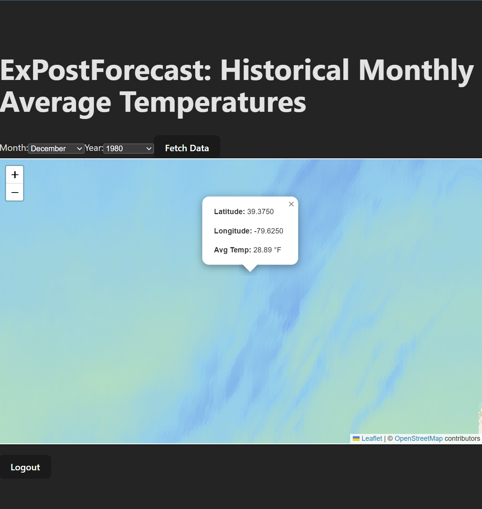

# xPostForecast

A full-stack web app that maps **historical monthly average temperatures across West Virginia** from NOAA nClimGrid data. You register, log in, pick a month between January 1895 and September 2022, and the app paints about 9,700 colored squares over a street map.

It is built with a React + Leaflet frontend, a Node.js/Express backend, Azure Database for MySQL, and deployment to Azure with GitHub Actions. It is also the **worked example** for WVU's CS 330 course.



> **Two ways to use this repository**
>
> - **Run or deploy xPostForecast yourself:** this README and the [backend](./backend/README.md) and [frontend](./frontend/README.md) READMEs explain how the app works and how to set it up.
> - **Build your own project (CS 330 students):** don't copy this repo. Follow the [student guides](https://tdevine1.github.io/xPostForecast/), which teach each step for *your* topic, and use this repo to see what a finished version looks like. For deployment, start with the [Sprint 4 guide](https://tdevine1.github.io/xPostForecast/students/sprint-4.html).

---

## What it does

- **Accounts:** register with an email, username, and password; log in and out. Passwords are stored only as bcrypt hashes, and a login is a signed token (JWT) in an HTTP-only cookie.
- **Temperature data:** for a logged-in user, the backend asks Microsoft's Planetary Computer for NOAA's monthly grid, picks out West Virginia, converts °C to °F, and returns the points.
- **Map:** the frontend draws each point as a colored square (dark blue at −10 °F to dark red at 110 °F) on an OpenStreetMap background, with a popup for each cell.

## Tech stack

| Part | Technology |
|---|---|
| Frontend | React 19, Vite, React Router, axios, Leaflet + React-Leaflet, chroma-js |
| Backend | Node.js 24, Express 5, mysql2, jsonwebtoken, bcryptjs, geotiff |
| Database | Azure Database for MySQL – Flexible Server (TLS) |
| Data | NOAA nClimGrid via the Microsoft Planetary Computer STAC API |
| Tests | Vitest, Testing Library, Supertest |
| Checks | oxlint, GitHub Actions, SonarQube Cloud |
| Hosting | Azure Static Web Apps (frontend), Azure App Service (backend) |

## How the pieces fit

On your computer:

```text
Browser ──► Vite dev server  http://localhost:5173   (React app)
   └──────► Express backend  http://localhost:5175   ──► Azure MySQL (over TLS)
                                                    └─► Planetary Computer (temperature data)
```

In Azure:

```text
                       push to main
   GitHub repo  ────────────────────────►  GitHub Actions
                                            ├─ deploy-frontend.yml: test → build (with VITE_BACKEND_API_URL) → upload
                                            └─ deploy-backend.yml:  test → upload (publish profile)
                                                  │                         │
                                                  ▼                         ▼
 Browser ── loads site ──►  Static Web App          App Service (Node 24)  ── TLS ──►  Azure MySQL
    │                       https://<swa>.azurestaticapps.net     https://<app>.azurewebsites.net
    └──────── API calls with auth cookie (CORS, credentials) ────────────►│
                                                                           └── HTTPS ──►  Planetary Computer
```

Online, the frontend and backend live on **different sites**, which shapes two settings:

- **CORS:** the backend's `FRONTEND_URL` must be the Static Web App's address exactly.
- **Cookies:** browsers only send cross-site cookies marked `SameSite=None; Secure`, so with `NODE_ENV=production` the backend sets the auth cookie as `HttpOnly; Secure; SameSite=None; Partitioned` (see [`backend/config/cookies.js`](./backend/config/cookies.js)).

## What is in this repository

```text
xPostForecast/
├── backend/        Express API: auth, temperature data, MySQL     → backend/README.md
├── frontend/       React app: login, register, map                → frontend/README.md
├── design/         Course design artifacts for this app (milestones 2–4)
├── docs/           The guides website (GitHub Pages): student guides, instructor runbook, scripts
├── images/         Screenshots used by the READMEs
├── sonar-project.properties     SonarQube Cloud settings
└── .github/workflows/
    ├── ci.yml                   lint, test, build, and (optionally) SonarQube on every push
    ├── deploy-backend.yml       deploys backend/ to App Service
    └── deploy-frontend.yml      deploys frontend/ to Static Web Apps
```

---

## Run it on your computer

You need **Node.js 24 LTS**, **Git**, and an **Azure Database for MySQL** server (the backend connects over TLS using Azure's certificate, so a plain local MySQL won't work without changing the code). Creating the server is covered in step 1.

1. **Get a database.** Create an Azure Database for MySQL Flexible Server (choose the smallest *Burstable* size, Standard_B1ms), allow your IP address under **Networking**, and run [`backend/db/schema.sql`](./backend/db/schema.sql) to create the `users` table. The click-by-click version is in the [backend README](./backend/README.md#2-run-it-locally) and the [instructor runbook](https://tdevine1.github.io/xPostForecast/deployment-steps.html#per-semester).
2. **Clone and install.**

   ```bash
   git clone https://github.com/tdevine1/xPostForecast.git
   cd xPostForecast
   cd backend && npm install && cd ..
   cd frontend && npm install && cd ..
   ```

3. **Create the two settings files** by copying the examples, then filling in `backend/.env` (database host, user, password, and a new `JWT_SECRET`). `frontend/.env` needs no edits locally.

   ```bash
   cp backend/.env.example backend/.env
   cp frontend/.env.example frontend/.env
   ```

   Never commit `.env` files. They are already in `.gitignore`.

4. **Start both programs**, each in its own terminal:

   ```bash
   cd backend  && npm run dev     # http://localhost:5175
   cd frontend && npm run dev     # http://localhost:5173
   ```

5. Open <http://localhost:5173>, **register**, **log in**, choose a month and year, and click **Fetch Data**. The first fetch for a month takes a few seconds; repeats are instant.

Run the checks any time with `npm test` and `npm run lint` in each folder.

## Deploy it to Azure

1. **Create the Azure resources:** a resource group, an App Service plan (**Basic B1**) with a Web App for Linux on **Node 24 LTS**, a Static Web App (**Free**), and the MySQL server from above. Follow the [instructor runbook](https://tdevine1.github.io/xPostForecast/deployment-steps.html#per-semester), or the [Azure scripts](https://tdevine1.github.io/xPostForecast/azure-scripts.html) if you need many copies. Choose these sizes on purpose: the portal's defaults are much more expensive.
2. **Deploy the backend** and set its App Service settings: see [Deploy to App Service](./backend/README.md#7-deploy-to-azure-app-service).
3. **Deploy the frontend:** see [Deploy to Static Web Apps](./frontend/README.md#5-deploy-to-azure-static-web-apps).
4. **Check the live site** with the list below.

The deploy workflows run only while the repository variable `DEPLOY_TO_AZURE` is `true`; otherwise they show as skipped, so a fork or a copy without Azure resources stays green. CI still tests every push.

### Check the live site

- [ ] `https://<your backend's default domain>/health` returns `{"ok":true,"env":"production"}`. Copy the address from the App Service's **Overview → Default domain** (apps made in the portal have a random suffix). The first request after a deploy can take a minute or more while the app wakes up.
- [ ] The Static Web App address loads; the browser console shows `Frontend API Base URL: https://<your-backend>.azurewebsites.net`.
- [ ] Register and log in work, and refreshing on `/map` keeps you logged in.
- [ ] Fetch Data draws temperatures on top of a real street map. Grey squares reading "Access blocked" mean the Referrer-Policy fix is missing ([frontend troubleshooting](./frontend/README.md#6-troubleshooting)).
- [ ] Logout returns you to `/login`, and `/map` then redirects there.
- [ ] No CORS errors in the console; no crashes or database errors in the App Service log stream.

---

## The sprints: one branch each

The app was built in four stages, kept as branches so you can see how it grew:

| Sprint | Branch | What it adds | What changed |
|--------|--------|--------------|--------------|
| 1 | [`sprint-1`](https://github.com/tdevine1/xPostForecast/tree/sprint-1) | React (Vite) frontend: Leaflet map and month/year selector | — |
| 2 | [`sprint-2`](https://github.com/tdevine1/xPostForecast/tree/sprint-2) | Express backend, Azure MySQL, login/registration with JWT cookies | [Sprint 1 → 2](https://github.com/tdevine1/xPostForecast/compare/sprint-1...sprint-2) |
| 3 | [`sprint-3`](https://github.com/tdevine1/xPostForecast/tree/sprint-3) | Real NOAA temperature data from the Planetary Computer STAC API | [Sprint 2 → 3](https://github.com/tdevine1/xPostForecast/compare/sprint-2...sprint-3) |
| 4 | [`main`](https://github.com/tdevine1/xPostForecast/tree/main) | Deployment to Azure Static Web Apps and App Service with GitHub Actions, plus SonarQube | [Sprint 3 → 4](https://github.com/tdevine1/xPostForecast/compare/sprint-3...main) |

`main` is the finished app and what this README describes. Switch with the branch dropdown on GitHub or `git switch sprint-2`.

### What Sprint 4 added

| Area | Change |
|---|---|
| `.github/workflows/deploy-backend.yml` | On pushes to `main` that touch `backend/`: install, test, remove dev packages, deploy to App Service |
| `.github/workflows/deploy-frontend.yml` | On pushes to `main` that touch `frontend/`: install, test, build with `VITE_BACKEND_API_URL`, upload to the Static Web App |
| `frontend/public/staticwebapp.config.json` | Sends unknown paths such as `/map` to `index.html` so a refresh doesn't 404, and sets `Referrer-Policy: strict-origin-when-cross-origin` so OpenStreetMap accepts the map tiles |
| `frontend/src/components/MapComponent.jsx` | The map layer sets `referrerPolicy`, so tile requests always carry a `Referer` |
| `.github/workflows/ci.yml` | Adds a `sonar` job (SonarQube Cloud), off until `SONAR_ENABLED` is `true` |
| `sonar-project.properties`, `npm run test:coverage` | SonarQube settings, and coverage reports from Vitest in both folders |

The backend needed no changes for the cloud: from Sprint 2 on it reads `PORT` and every setting from the environment, and switches cookie behavior with `NODE_ENV`.

## Code quality and coverage

CI can send the code and its coverage reports to [SonarQube Cloud](https://sonarcloud.io). The `sonar` job in [`ci.yml`](./.github/workflows/ci.yml) stays off until the repository variable `SONAR_ENABLED` is `true` and a `SONAR_TOKEN` secret exists. The settings are in [`sonar-project.properties`](./sonar-project.properties), and the [SonarQube guide](https://tdevine1.github.io/xPostForecast/students/sonarqube.html) explains each part.

## Design artifacts

[`design/`](./design) holds the course's design deliverables for this app: user stories, a grammatical parse, user story diagrams, CRC cards, three architecture views, and four component designs (pseudocode and flowchart for each). They describe the code on this branch.

---

## Guides

Everything is on the guides site, **<https://tdevine1.github.io/xPostForecast/>** (source in [`docs/`](./docs)):

| Guide | For |
|---|---|
| [Git and GitHub help](https://tdevine1.github.io/xPostForecast/students/git-guide.html) | Students working on a team repository |
| [Sprint 1: Frontend and your team repo](https://tdevine1.github.io/xPostForecast/students/sprint-1.html) | Students setting up tools, their team repo, and a React app |
| [Sprint 2: Backend and login](https://tdevine1.github.io/xPostForecast/students/sprint-2.html) | Students building a backend with a database and login |
| [Sprint 3: Connect to an API](https://tdevine1.github.io/xPostForecast/students/sprint-3.html) | Students connecting their own project to a data API |
| [Sprint 4: Deploy to the cloud](https://tdevine1.github.io/xPostForecast/students/sprint-4.html) | Students putting their own project on Azure |
| [Writing GitHub workflows](https://tdevine1.github.io/xPostForecast/students/github-workflows.html) | Students writing CI and deploy workflows |
| [Testing with SonarQube Cloud](https://tdevine1.github.io/xPostForecast/students/sonarqube.html) | Students (Milestone 6) |
| [Developing with AI](https://tdevine1.github.io/xPostForecast/students/ai-guide.html) | Students |
| [Instructor guide](https://tdevine1.github.io/xPostForecast/instructors.html), [Azure scripts](https://tdevine1.github.io/xPostForecast/azure-scripts.html) | Instructors |
| [Glossary](https://tdevine1.github.io/xPostForecast/glossary.html) | Everyone: plain-English definitions |

## Maintaining this repo (instructors)

**Per-semester Azure setup** for the reference deployment is in the [instructor runbook](https://tdevine1.github.io/xPostForecast/deployment-steps.html).

**Fixing something that exists in several sprints:** make the fix on the **earliest** sprint branch that has the problem, then merge it forward so every later sprint gets it:

```bash
git switch sprint-2 && git commit -am "Fix ..." && git push
git switch sprint-3 && git merge sprint-2 && git push
git switch main     && git merge sprint-3 && git push
```

CI runs on every branch, so each merge is tested. Changes that only make sense in a later sprint go directly on that sprint's branch.

**The guides site** (`docs/`) lives only on `main` and is published by GitHub Pages (Settings → Pages → Deploy from a branch → `main` / `/docs`).

## Credits

The instructor runbook in [`docs/`](./docs) was written by **Grace Hanson** (WVU) under Tom Devine; its original commit history is preserved in this repository. See [`docs/LICENSE`](./docs/LICENSE).

## License

MIT. See [LICENSE](./LICENSE).
