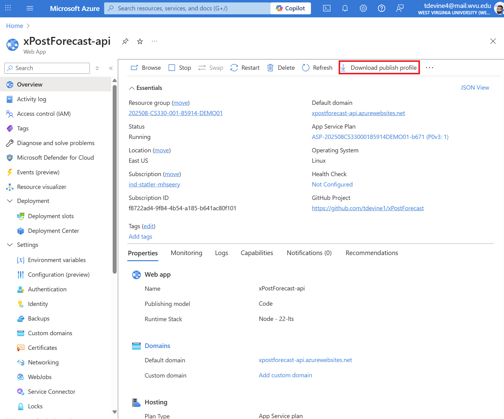
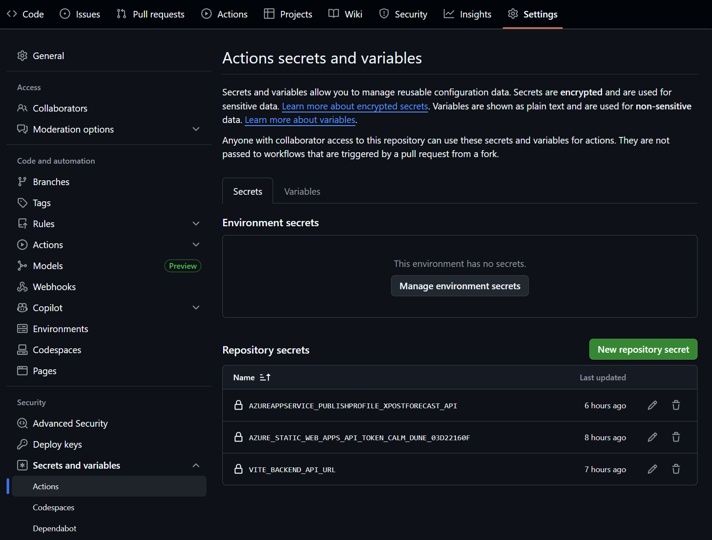
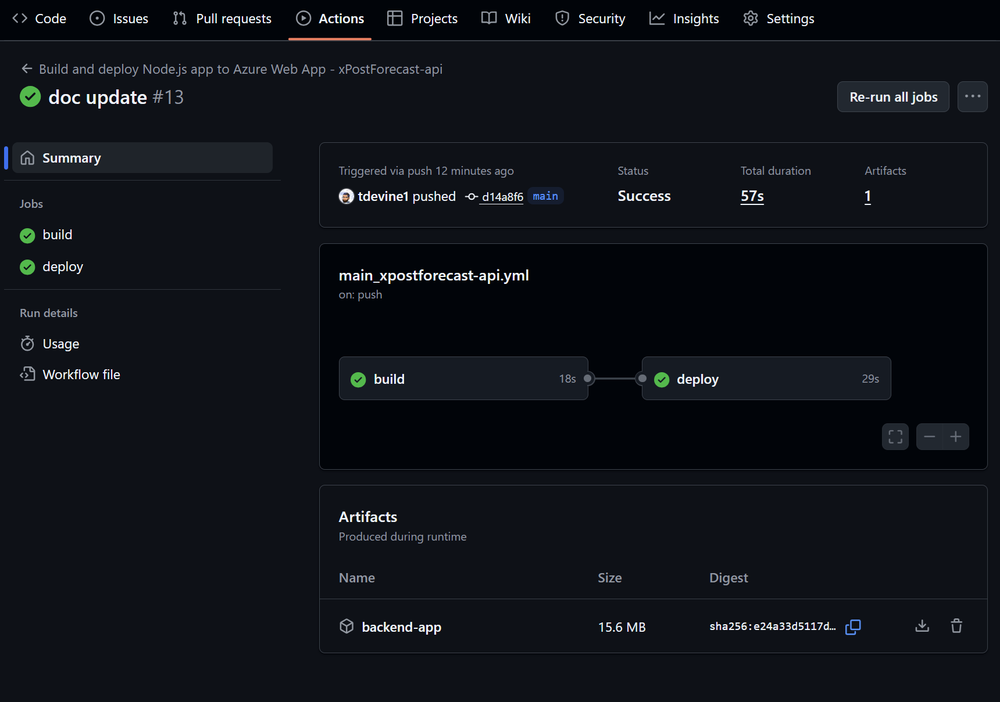
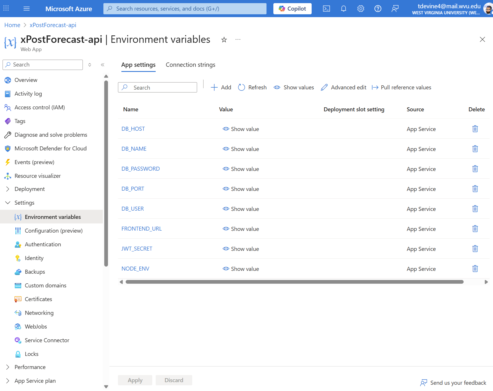
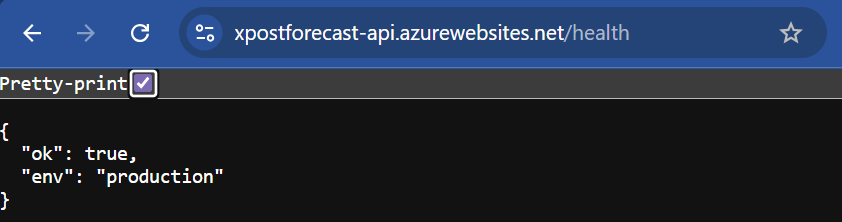
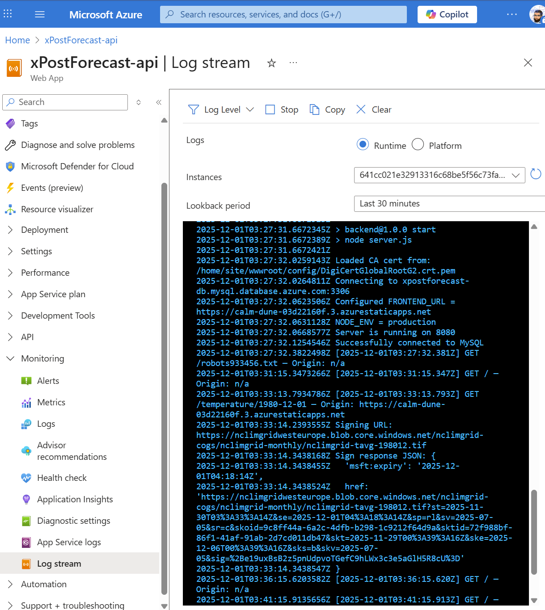

# xPostForecast Backend

The Express API behind xPostForecast. It handles registration and login, stores users in **Azure Database for MySQL**, and serves NOAA temperature data to logged-in users.

> **Setting up this backend yourself?** Read on. **Building your own project for CS 330?** Don't copy this one: follow the [student guides](https://tdevine1.github.io/xPostForecast/), such as the [Sprint 4 deployment guide](https://tdevine1.github.io/xPostForecast/students/sprint-4.html), and use this code to see how a finished backend looks.

What it provides:

- Registration, login, and logout, with a JWT in an HTTP-only cookie
- Azure Database for MySQL access over TLS
- `GET /temperature/:date`, which returns monthly average temperatures for West Virginia as map points (logged-in users only)
- A `/health` check, for you and for Azure

The frontend that talks to it is in [`../frontend/README.md`](../frontend/README.md). The overall picture is in the [root README](../README.md).

---

## 1. What it is made of

**Tech stack**

- **Runtime:** Node.js 24 LTS (ES modules, built-in `fetch`)
- **Framework:** Express 5
- **Database:** Azure Database for MySQL via `mysql2/promise`
- **Auth:** JWT (`jsonwebtoken`) in an HTTP-only cookie (`cookie-parser`); passwords hashed with `bcryptjs`; `express-rate-limit` on login and register
- **Climate data:** Microsoft Planetary Computer STAC API, with `geotiff` to read Cloud Optimized GeoTIFFs
- **Tests:** Vitest + Supertest; **lint:** oxlint

**Folder structure** (each folder also has its own short README):

```text
backend/
├── app.js                        middleware + routes (exported; tests import it)
├── server.js                     entry point: checks settings, starts listening
├── config/
│   ├── env.js                    loads backend/.env (local development only)
│   ├── database.js               MySQL connection pool over TLS
│   ├── cookies.js                auth cookie options (development vs production)
│   └── DigiCertGlobalRootG2.crt.pem   CA certificate for Azure MySQL (public, not a secret)
├── db/schema.sql                 creates the authdb database and users table
├── middleware/authMiddleware.js  checks the JWT cookie on protected routes
├── routes/
│   ├── auth.js                   /auth/register, /login, /test, /logout
│   └── stac.js                   /temperature/:date
├── sign/sign.js                  signs Planetary Computer download URLs
├── tests/                        auth, temperature, sign (URL safety), config, and app-mode tests
├── vitest.config.js              test and coverage settings
└── .env.example                  template for your .env
```

---

## 2. Run it locally

You need **Node.js 24 LTS** and an **Azure Database for MySQL – Flexible Server**. The code verifies the server's TLS certificate against Azure's, so it is built for Azure's MySQL.

### 2.1 Create the database and allow your computer

1. Create the server in the Azure portal (smallest *Burstable* size, **Standard_B1ms**; see the [instructor runbook](https://tdevine1.github.io/xPostForecast/deployment-steps.html#per-semester) for every setting).
2. On the server's **Networking** page, tick **Allow public access from any Azure service within Azure to this server** (the deployed backend needs it) and click **Add current client IP address**, then **Save**. Your IP changes between home, campus, and hotspots, so repeat this when you move.
3. Create the schema. The quickest way needs nothing installed: portal → your MySQL server → **Connect** → open **Cloud Shell** (choose **Bash**; if asked about storage, choose **No storage account required**), run the `mysql` command the page shows, type your admin password at the prompt (never on the command line), then copy all of [`db/schema.sql`](./db/schema.sql) and paste it at the `mysql>` prompt. Check with:

   ```sql
   SHOW TABLES FROM authdb;
   DESCRIBE authdb.users;
   exit
   ```

The schema creates the `authdb` database and a `users` table with unique `email` and `username` columns and a `password_hash` column. Running it again is harmless. (Browsing the database from VS Code with SQLTools, or running the schema with the `mysql` command-line client, is explained in the [Sprint 2 backend guide](https://github.com/tdevine1/xPostForecast/blob/sprint-2/backend/README.md).)

### 2.2 Install, configure, run

```bash
cd backend
npm install
cp .env.example .env      # then edit .env
npm run dev               # restarts when you save a file; use `npm start` for a plain start
```

Fill in `.env` (see section 3), generating a signing secret with:

```bash
node -e "console.log(require('crypto').randomBytes(32).toString('hex'))"
```

> **Never commit `.env`.** `.gitignore` excludes it; run `git status` before every commit to be sure.

Expected output:

```text
Connecting to MySQL at <your-server>.mysql.database.azure.com:3306
Configured FRONTEND_URL = http://localhost:5173
NODE_ENV = development
Server is running on 5175
Successfully connected to MySQL
```

(The last two lines can appear in either order.) Then open <http://localhost:5175/health>, which should show `{"ok":true,"env":"development"}`.

---

## 3. Settings (environment variables)

All settings come from the environment, so the same code runs on your laptop (from `.env`) and on Azure (from App Service settings).

| Name | Meaning | Local value | On Azure |
|---|---|---|---|
| `PORT` | Port to listen on | `5175` | **Don't set it.** App Service picks one and sets it for you |
| `FRONTEND_URL` | The one website allowed to call this API (CORS) | `http://localhost:5173` | The Static Web App address, exactly, no trailing slash |
| `NODE_ENV` | Switches production behavior (section 7.3) | `development` | `production` |
| `JWT_SECRET` | Secret used to sign login tokens | a generated string | a **different** generated string |
| `DB_HOST` | MySQL server name | `<server>.mysql.database.azure.com` | same |
| `DB_USER`, `DB_PASSWORD` | Database login | your admin login | same |
| `DB_NAME` | Database name | `authdb` | same |
| `DB_PORT` | Database port | `3306` (optional) | same |

`server.js` refuses to start, and lists what is missing, if `FRONTEND_URL`, `JWT_SECRET`, `DB_HOST`, `DB_USER`, `DB_PASSWORD`, or `DB_NAME` is empty. That is easier to diagnose than a crash later. `config/env.js` reads `.env` with Node's built-in `process.loadEnvFile()`, so no `dotenv` package is needed.

---

## 4. Routes

| Route | Method | Auth | Description |
|---|---|---|---|
| `/health` | GET | none | `{ ok: true, env }`; works without touching the database |
| `/auth/register` | POST | none | `{ email, username, password }` → `201`; `400` missing field or password under 8 characters; `409` username or email taken |
| `/auth/login` | POST | none | `{ username, password }` → `200` and a `token` cookie; `400` missing field; `401` wrong credentials |
| `/auth/test` | GET | cookie | `{ ok: true, user }` or `401`; the frontend uses it to ask "am I logged in?" |
| `/auth/logout` | POST | none | clears the cookie |
| `/temperature/:date` | GET | **cookie** | temperature points for that month (section 5) |

How logins work:

- Passwords are stored only as **bcrypt hashes**.
- A successful login sets a cookie that is `HttpOnly` (page JavaScript can't read it) and holds a JWT valid for **1 hour**.
- Login and register allow at most **20 attempts per IP address per 15 minutes**, which slows down password guessing. The counter lives in memory, so restarting the app resets it.
- In `app.js` the auth middleware runs *before* the temperature router, so a request without a valid cookie gets `401` and never reaches Planetary Computer:

  ```js
  app.use('/temperature', authMiddleware, stacRoutes);
  ```

**CORS and cookies.** The frontend and backend are different origins, so `app.js` allows exactly one, `FRONTEND_URL`, and allows it to send cookies (`credentials: true`). The frontend must opt in on every request (`withCredentials: true`). Cookie flags live in `config/cookies.js`, one place used by login and logout so they always match.

Try the routes with curl (local):

```bash
curl -i -X POST http://localhost:5175/auth/register -H "Content-Type: application/json" \
  --data '{"email":"alice@example.com","username":"alice","password":"correct-horse"}'

curl -i -X POST http://localhost:5175/auth/login -H "Content-Type: application/json" \
  --data '{"username":"alice","password":"correct-horse"}' -c cookies.txt

curl -s http://localhost:5175/auth/test -b cookies.txt
curl -s http://localhost:5175/temperature/2020-07-01 -b cookies.txt | head -c 300
```

---

## 5. `GET /temperature/:date` (`routes/stac.js`)

`:date` is `YYYY-MM-DD` (the frontend sends the first of the month); only the year and month are used.

| Status | Body | When |
|---|---|---|
| `200` | `[{ "lat": 40.6042, "lon": -82.6042, "tavg": 74.88 }, …]` (about 9,700 points) | Data found |
| `400` | `{ "error": "Date must be YYYY-MM-DD" }` | Malformed date, or month outside 01–12 |
| `401` | `{ "error": "Not logged in" }` | No or invalid cookie |
| `404` | `{ "error": "No temperature data is available for 2022-12" }` | Month not in the dataset (before 1895-01 or after 2022-09) |
| `502` | `{ "error": "The temperature data service is unavailable. Try again later." }` | Planetary Computer failed or returned something unexpected |

`502 Bad Gateway` means "a server we depend on failed", which tells the frontend (and you) that the problem is not the request.

**How it works**

1. **Cache check.** Results are kept in memory per month (up to 24 months), because historical data never changes. A cached month returns in milliseconds.
2. **STAC search.** `POST https://planetarycomputer.microsoft.com/api/stac/v1/search` with the collection `noaa-nclimgrid-monthly`, a bounding box around West Virginia, and a date in the middle of the month. Each item covers a whole month. No item means `404`.
3. **Pick the asset by name.** An item has several assets (`prcp`, `tavg`, `tmax`, `tmin`, …). The code uses `item.assets.tavg`. Picking by name matters: the order of keys in JSON isn't guaranteed.
4. **Sign the URL** with `sign/sign.js`. The file lives in Azure Blob Storage, which allows downloads only with a short-lived token; Planetary Computer's signing endpoint returns the same URL with a token added. The asset URL comes from another service's response, so it is **checked first**: only `https` addresses on `*.blob.core.windows.net` are accepted, both before signing and before downloading (see [`sign/README.md`](./sign/README.md)). Anything else is refused and the route answers `502`.
5. **Read the grid.** The backend downloads the Cloud Optimized GeoTIFF (about 1.2 MB for the whole U.S.), and `geotiff` decodes only the window covering West Virginia.
6. **Convert cells to points.** For each cell: skip "no data" values; find the cell's **center**; keep it only if the center is inside the bounding box; convert °C to °F. The result is capped at 10,000 points as a safety limit.
7. **Cache and return** the JSON array.

`samplePoints()` (step 6) and `c2f()` are exported so they can be tested without the network. The route needs no API key. It does need outbound internet access to `planetarycomputer.microsoft.com` and `*.blob.core.windows.net`, which Azure allows by default.

---

## 6. Tests and quality checks

```bash
npm test                 # auth + temperature tests
npm run lint             # oxlint
npm run test:coverage    # tests plus a coverage report in coverage/ (lcov for SonarQube)
```

The tests send real HTTP requests to the Express app (imported from `app.js`, so no server or port is needed) and replace the database with a mock, and `fetch` and `geotiff` with fakes, so they run offline in seconds and work in GitHub Actions. They check things that are easy to break without noticing: passwords are stored only as hashes, the cookie is `HttpOnly`, a token signed with the wrong secret is rejected, `/temperature` requires login, `404` and `502` appear in the right situations, and the server refuses to download from an address that is not Azure Blob Storage.

**SonarQube Cloud** reads the coverage report on every push and reports bugs, security problems, and untested code. The `sonar` job in [`ci.yml`](../.github/workflows/ci.yml) stays off until a repository **Admin** adds the `SONAR_TOKEN` secret and sets the variable `SONAR_ENABLED` to `true`. See the [SonarQube guide](https://tdevine1.github.io/xPostForecast/students/sonarqube.html).

---

## 7. Deploy to Azure App Service

You need an App Service (a *Web App for Linux*) on the **Node 24 LTS** runtime, in a resource group with the MySQL server. Section "Deploy it to Azure" of the [root README](../README.md#deploy-it-to-azure) links to how to create it. Then:

### 7.1 Let GitHub deploy to it

GitHub Actions signs in to App Service with the app's **publish profile**.

1. Azure portal → **App Services** → your app → **Overview** → **Download publish profile**. It downloads an XML file (`<app-name>.PublishSettings`).

   

   If the button is greyed out, basic-auth publishing is off for the app. Turn it on under **Settings → Configuration → General settings → SCM Basic Auth Publishing Credentials**.

2. In your GitHub repository: **Settings → Secrets and variables → Actions** (only a repository **Admin** can see Settings).
   - **Secrets** tab → **New repository secret**: name `APP_SERVICE_PUBLISH_PROFILE`, value the **entire** contents of the file.
   - **Variables** tab → **New repository variable**: `AZURE_WEBAPP_NAME` = the App Service's name, exactly as in the portal; and `DEPLOY_TO_AZURE` = `true` (the deploy workflows skip themselves unless this is `true`).

   

   *(This screenshot is from a repo whose secrets Azure generated, so the names differ. Use the names above.)*

3. Delete the downloaded file. The publish profile is a password for your app: it belongs in a secret and never in git. (`.gitignore` also ignores `*.PublishSettings` as a safety net.)

### 7.2 The deploy workflow

[`.github/workflows/deploy-backend.yml`](../.github/workflows/deploy-backend.yml) runs on every push to `main` that touches `backend/` (and has a **Run workflow** button). It installs with `npm ci`, runs `npm test` (a failing test stops the deployment), removes dev-only packages with `npm prune --omit=dev`, and uploads `backend/` with `azure/webapps-deploy`. It also fails early with a plain message if the secret or variable is missing. Every line is explained in the [workflows guide](https://tdevine1.github.io/xPostForecast/students/github-workflows.html#backend).

Keep only **one** backend deploy workflow. If the App Service's Deployment Center added its own (named like `main_<app-name>.yml`), delete it, or every push deploys twice.

Push to `main`, or choose **Actions → Deploy backend (App Service) → Run workflow**, and wait for the green check:



### 7.3 Set the App Service settings

The App Service has no `.env` file (and must not). Type the settings from section 3 into the portal: your App Service → **Settings → Environment variables → App settings** → **+ Add** for each, then **Apply** (the app restarts). Don't add `PORT`.



Why `NODE_ENV=production` matters. It switches on two behaviors:

- **Cookie flags** (`config/cookies.js`): the frontend (`*.azurestaticapps.net`) and backend (`*.azurewebsites.net`) are **different sites**. Browsers send a cookie across sites only if it is marked `SameSite=None` and `Secure`, so in production the auth cookie is `HttpOnly; Secure; SameSite=None; Partitioned`. With the development setting (`SameSite=Lax`), login would return 200 but the browser would never send the cookie back, so every page would act logged out.
- **`trust proxy`** (`app.js`): App Service receives HTTPS and forwards plain HTTP to the app. Trusting the proxy's headers lets Express see the original request as HTTPS (needed for `Secure` cookies) and the real client IP (needed for rate limiting).

The port: App Service chooses it and passes it as `PORT` (commonly 8080). `server.js` reads it with `Number(process.env.PORT) || 5175`. A hard-coded port would never be reached by App Service's health probe.

### 7.4 Database connectivity

The server and database must already exist (section 2.1) with **Allow public access from any Azure service within Azure** ticked, so the App Service can connect. The CA certificate is part of the code, so it deploys with it. If the log stream shows `MySQL connection failed on startup` with `ETIMEDOUT`, that setting is the usual cause.

### 7.5 Verify

Open `https://<your backend's default domain>/health`. Copy the address from the App Service's **Overview → Default domain** instead of typing it: a portal-created app has a random-looking suffix. You should see:

```json
{ "ok": true, "env": "production" }
```

If `env` says `development`, `NODE_ENV` isn't set.



> **The first request can be slow.** On the Basic plan the app goes to sleep after about 20 minutes with no visitors, and it restarts after every deploy. The first request after either can take a minute or more (a *cold start*); the next is fast. That is normal, not a failed deployment. **Always On** (App Service → Settings → Configuration → General settings; Basic and above) keeps it awake.

Then watch it start: portal → your App Service → **Monitoring → Log stream**, and **Restart** from Overview:

```text
Connecting to MySQL at <server>.mysql.database.azure.com:3306
Configured FRONTEND_URL = https://<your-swa>.azurestaticapps.net
NODE_ENV = production
Server is running on 8080
Successfully connected to MySQL
```

After that each request is logged, for example `[2026-…] GET /auth/test — Origin: https://<your-swa>.azurestaticapps.net`.



*(Screenshot from an earlier version of the backend, which logged a few extra lines. The text block above shows the current output.)*

Next, deploy the frontend: [`../frontend/README.md`](../frontend/README.md#5-deploy-to-azure-static-web-apps).

---

## 8. Troubleshooting

| Symptom | Likely cause | Fix |
|---|---|---|
| `Missing required environment variables: …` on start | `.env` (or App Service setting) missing or misspelled | Local: copy `.env.example` to `.env` and fill it in. Azure: add it under Environment variables, then Apply |
| `MySQL connection failed on startup` + `ETIMEDOUT` | Firewall: your IP (local) or "Allow Azure services" (deployed) | Add your current IP under the server's Networking; tick the Azure services box |
| `Access denied for user` | Wrong `DB_USER` or `DB_PASSWORD` | Compare with the **Connect** page in the portal |
| `ER_BAD_DB_ERROR: Unknown database 'authdb'` | Schema not created | Run `db/schema.sql` (section 2.1) |
| TLS errors (`self-signed certificate`) | Wrong or missing CA file | Use `config/DigiCertGlobalRootG2.crt.pem`, downloaded from the server's Networking page |
| Cloud Shell: `ERROR 2002 (HY000)` | Server doesn't allow Azure services | Tick **Allow public access from any Azure service within Azure** under Networking |
| `409` on register | Username or email already exists | Choose another, or delete the row |
| `429 Too Many Requests` | Login/register rate limit | Wait 15 minutes or restart the backend |
| `401` from `/temperature/...` | Not logged in, or the cookie wasn't sent | Log in; the frontend must send cookies (`withCredentials: true`) |
| `404 No temperature data is available…` | Month not in the dataset | Choose a month from 1895-01 to 2022-09 |
| `502` and `Error fetching temperature data` in the log | Planetary Computer unreachable or slow | Retry; the log line shows the underlying error |
| CORS error mentioning `Access-Control-Allow-Origin` | `FRONTEND_URL` doesn't match the frontend's address exactly | Copy the address; no trailing slash |
| Login returns 200 but you are logged out at once | Cookie not sent between the two sites | `NODE_ENV=production` on Azure; see 7.3 and the [frontend guide](../frontend/README.md#55-cookies-between-two-sites) |
| Workflow: `AZURE_WEBAPP_NAME is not set` / `APP_SERVICE_PUBLISH_PROFILE is not set` | Missing GitHub variable or secret | Add it (7.1); names are case-sensitive |
| Workflow fails at the deploy step with an authentication error | Old or wrong publish profile | Download a fresh one and replace the secret |
| Workflow fails at `npm test` | A test fails | Run `npm test` locally and fix it |
| Workflow shows as skipped | `DEPLOY_TO_AZURE` isn't `true` | Set the repository variable |
| "Application Error" page, or the app keeps restarting | Startup crash | Read the first error in the log stream |
| `/health` hangs the first time, then works | Cold start | Wait a minute and retry; don't redeploy |
| The frontend can't find the backend (`ERR_NAME_NOT_RESOLVED`) | `VITE_BACKEND_API_URL` uses a guessed address | Copy the **Default domain**, then redeploy the frontend |

---

## 9. References

- Express: <https://expressjs.com/>
- mysql2: <https://sidorares.github.io/node-mysql2/docs>
- jsonwebtoken: <https://github.com/auth0/node-jsonwebtoken>
- bcryptjs: <https://github.com/dcodeIO/bcrypt.js>
- express-rate-limit: <https://express-rate-limit.mintlify.app/>
- Supertest: <https://github.com/ladjs/supertest>
- Microsoft Planetary Computer: <https://planetarycomputer.microsoft.com/>
- MDN CORS: <https://developer.mozilla.org/docs/Web/HTTP/Guides/CORS>
