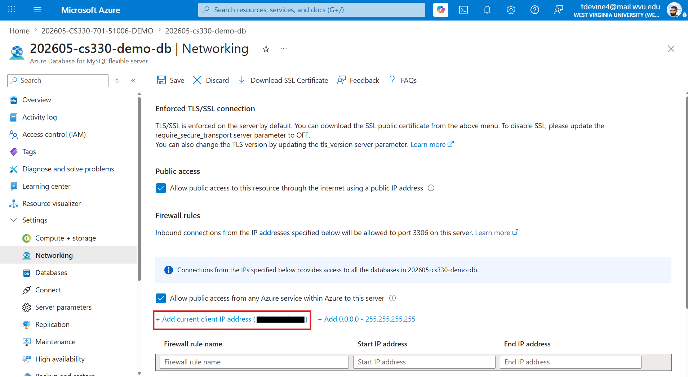
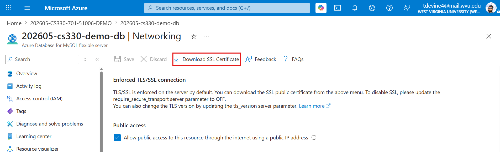

# Sprint 2 Backend: Setup & Database Integration Guide

In **Sprint 2**, you build your first backend: an Express server that handles user authentication and connects to an **Azure Database for MySQL** server over **TLS**. This guide matches the code in this folder: ES modules, `mysql2/promise`, JWT login stored in an **HTTP-only cookie**, and **email + username + password** registration.

> This is the **reference implementation**. Build the equivalent `backend/` in your own project repo; don't clone or fork this one.

*Flow: React (Vite) ⇄ cookie-based auth ⇄ Express ⇄ Azure MySQL (TLS)*

---

## 📂 Backend Folder Structure

```text
backend/
├── app.js                         # middleware + routes (exported; tests import it)
├── server.js                      # entry point: checks env vars, starts listening
├── config/
│   ├── env.js                     # loads backend/.env (local development only)
│   ├── database.js                # MySQL connection pool over TLS
│   ├── cookies.js                 # auth cookie options (development vs production)
│   └── DigiCertGlobalRootG2.crt.pem   # CA certificate for Azure MySQL
├── db/
│   └── schema.sql                 # creates the authdb database and users table
├── middleware/
│   └── authMiddleware.js          # JWT cookie check for protected routes
├── routes/
│   └── auth.js                    # /auth/register, /login, /test, /logout
├── tests/
│   └── auth.test.js               # API tests (database mocked)
└── .env.example                   # template for your .env
```

---

## 🛠 Prerequisites

- **Node.js 24 LTS**
- **VS Code** (the **SQLTools** extensions from Sprint 1 are optional, for browsing the database)
- An **Azure Database for MySQL – Flexible Server** (your instructor provides the host, admin user, and password)
- Your current public IP address allowed in **Azure Portal → your MySQL server → Networking → Firewall rules**



---

## 1) Install Dependencies

```bash
cd backend
npm install
```

---

## 2) Configure Environment Variables

Copy the template and edit it:

```bash
cp .env.example .env
```

```ini
PORT=5175
FRONTEND_URL=http://localhost:5173
NODE_ENV=development

JWT_SECRET=<paste a generated secret here>

DB_HOST=<your-server>.mysql.database.azure.com
DB_USER=<your-admin-user>
DB_PASSWORD=<your-password>
DB_NAME=authdb
DB_PORT=3306
```

Generate a JWT secret with:

```bash
node -e "console.log(require('crypto').randomBytes(32).toString('hex'))"
```

> **Never commit `.env`.** The repo's `.gitignore` excludes it; run `git status` before every commit to be sure.

`server.js` refuses to start, and lists what's missing, if any of `FRONTEND_URL`, `JWT_SECRET`, `DB_HOST`, `DB_USER`, `DB_PASSWORD`, or `DB_NAME` is empty. `config/env.js` reads `.env` with Node's built-in `process.loadEnvFile()`, so no `dotenv` package is needed.

---

## 3) Get the SSL (CA) Certificate

Azure MySQL requires encrypted connections, and the backend verifies the server's certificate against a CA certificate. This repo already includes `config/DigiCertGlobalRootG2.crt.pem`. In your own project, download it from Azure:

1. **Azure Portal** → your **MySQL Flexible Server**
2. Open **Networking**
3. Click **Download SSL Certificate**



Save it in your backend's `config/` folder:

```bash
# Example (adjust the download path)
mv ~/Downloads/DigiCertGlobalRootG2.crt.pem backend/config/DigiCertGlobalRootG2.crt.pem
```

---

## 4) Create the Database and `users` Table (Azure Portal)

The quickest way to create the schema is from the Azure Portal itself: its **Connect** page opens a MySQL session in **Azure Cloud Shell**, a terminal in your browser, so there's nothing to install, and this step works even before your IP address is in the firewall rules.

1. **Azure Portal** → your **MySQL Flexible Server** → **Connect** (on the **Overview** toolbar, or under **Settings**).
2. Open **Cloud Shell** from the Connect page. The first time, choose **Bash**; if it asks about storage, choose **No storage account required**.
3. Run the `mysql` command the Connect page shows (your server name and admin user are already filled in), and type your admin password when asked. You're connected when you see the `mysql>` prompt.
4. Open [`db/schema.sql`](./db/schema.sql) in VS Code, copy all of it, and paste it at the `mysql>` prompt (right-click → **Paste**, or **Shift+Insert**). Each statement prints `Query OK`.
5. Check the result, then leave:

   ```sql
   SHOW TABLES FROM authdb;
   DESCRIBE authdb.users;
   exit
   ```

The schema creates the `authdb` database and this table:

```sql
CREATE TABLE IF NOT EXISTS users (
  id INT AUTO_INCREMENT PRIMARY KEY,
  email VARCHAR(255) NOT NULL UNIQUE,
  username VARCHAR(255) NOT NULL UNIQUE,
  password_hash VARCHAR(255) NOT NULL,
  created_at TIMESTAMP DEFAULT CURRENT_TIMESTAMP
);
```

The `UNIQUE` constraints are what stop two accounts from sharing a username or email; the backend turns that database error into a `409` response. Running the file again is harmless: `IF NOT EXISTS` skips anything that's already there.

> **Type the password at the prompt, never on the command line.** `mysql -p` asks for it without showing it. Writing it into the command (`-pMyPassword`) saves it in the shell's history, where anyone using that shell later can read it.

If Cloud Shell can't connect (`ERROR 2002 (HY000): Can't connect to MySQL server`), the server isn't allowing connections from Azure services. Ask your instructor to turn on **Allow public access from any Azure service within Azure to this server** in **Networking**, or run the file with SQLTools instead (see **Optional: Browse the Database** below).

---

## 5) Run the Backend

```bash
npm run dev     # restarts automatically when you save a file (node --watch)
# or
npm start       # plain start, as on Azure
```

**Expected output:**

```text
Connecting to MySQL at <your-server>.mysql.database.azure.com:3306
Configured FRONTEND_URL = http://localhost:5173
NODE_ENV = development
Server is running on 5175
Successfully connected to MySQL
```

(The last two lines can appear in either order: the server and the database connection start at the same time.)

`Successfully connected to MySQL` confirms your computer can reach the database. If you see `MySQL connection failed on startup` with `ETIMEDOUT` instead, add your current public IP in **Azure Portal → your MySQL server → Networking** (it changes between home, campus, and hotspots) and start the backend again.

Check it's alive at <http://localhost:5175/health>, which should return `{"ok":true,"env":"development"}`.

---

## 6) Test the Auth Routes

All routes are mounted under `/auth`:

| Route | Method | Body | Success | Errors |
|---|---|---|---|---|
| `/auth/register` | POST | `{ email, username, password }` | `201` | `400` missing field or password under 8 characters, `409` username/email taken |
| `/auth/login` | POST | `{ username, password }` | `200`, sets the `token` cookie | `400` missing field, `401` wrong credentials |
| `/auth/test` | GET | — | `200 { ok: true, user: { id, username } }` | `401` no cookie or invalid/expired token |
| `/auth/logout` | POST | — | `200`, clears the cookie | — |

Login and register allow at most **20 attempts per IP address per 15 minutes** (`express-rate-limit`), which slows down password guessing.

**curl examples (local development):**

```bash
# Register
curl -i -X POST http://localhost:5175/auth/register \
  -H "Content-Type: application/json" \
  --data '{"email":"alice@example.com","username":"alice","password":"correct-horse"}'

# Login (saves the cookie to cookies.txt)
curl -i -X POST http://localhost:5175/auth/login \
  -H "Content-Type: application/json" \
  --data '{"username":"alice","password":"correct-horse"}' \
  -c cookies.txt

# Check the session (sends the saved cookie)
curl -i http://localhost:5175/auth/test -b cookies.txt

# Logout
curl -i -X POST http://localhost:5175/auth/logout -b cookies.txt
```

---

## 7) Automated Tests

```bash
npm test        # Vitest + Supertest
npm run lint    # oxlint
```

`tests/auth.test.js` sends real HTTP requests to the Express app (imported from `app.js`, so no server or port is needed) and replaces the database with a mock, so the tests run anywhere, including GitHub Actions. They check things that are easy to break without noticing, for example that passwords are stored only as hashes, the cookie is `HttpOnly`, and a token signed with the wrong secret is rejected.

---

## 🔎 Optional: Browse the Database from VS Code (SQLTools)

You don't need this to build or run the app, but it's handy for looking at the `users` table while you test registration, without opening the portal. It uses the **SQLTools** extension and its **SQLTools MySQL/MariaDB/TiDB** driver (suggested in Sprint 1; VS Code offers them when you open this repo). It connects from **your** computer, so it needs the firewall rule from the prerequisites.

1. Click the **SQLTools** icon (a database cylinder) in VS Code's left sidebar → **Add New Connection** → **MySQL**.
2. Fill in the form:

   | Field | Value |
   |---|---|
   | Connection name | anything, e.g. `xPostForecast Azure` |
   | Connect using | **Server and Port** |
   | Server Address | your `DB_HOST`, e.g. `<your-server>.mysql.database.azure.com` |
   | Port | `3306` |
   | Database | `authdb` |
   | Username | your `DB_USER` |
   | **Password mode** | **SQLTools Driver Credentials** (the default) or **Ask on connect**. **Never "Save as plaintext in settings"**; see the box below. |
   | MySQL driver specific options → SSL | **Enabled**, with **Certificate Authority (CA) Certificate File** set to `backend/config/DigiCertGlobalRootG2.crt.pem` |

3. Click **Test Connection**, then **Save Connection**, then connect to it from the SQLTools sidebar. If the test times out, add your current IP address in Azure → MySQL server → **Networking**.
4. Open a new SQL file (or use the query editor SQLTools opens) and run:

   ```sql
   SELECT CURRENT_USER();
   SELECT id, email, username, created_at FROM users;
   ```

   Run a query by placing the cursor in it and pressing **Ctrl+E Ctrl+E** (**Cmd+E Cmd+E** on macOS), or with the **Run on active connection** link SQLTools shows above the query. The table is empty until someone registers (step 6).

These are the same `DB_HOST` / `DB_USER` / `DB_PASSWORD` values as in `.env`. SQLTools can also run the schema if Cloud Shell isn't available: connect with **Database** set to `mysql` (since `authdb` doesn't exist yet), open `db/schema.sql`, select all (**Ctrl+A**), and run it (**Ctrl+E Ctrl+E**).

> ### 🔐 Where SQLTools keeps your connection (read this)
>
> SQLTools saves the connection in **`.vscode/settings.json`** inside your project. What it saves depends on **Password mode**:
>
> - **SQLTools Driver Credentials**: the password goes into VS Code's secure credential storage, not the file.
> - **Ask on connect**: the password isn't stored anywhere; you type it each time.
> - **Save as plaintext in settings**: the password is written **in plain text** into `.vscode/settings.json`.
>
> If that file is ever committed, everyone who can see the repository, now or later, can read the password, and removing the file in a later commit doesn't help: it stays in the git history. **This reference repository made exactly this mistake once**: a database password saved by SQLTools was committed and stayed visible in the history until the history was rewritten.
>
> Two layers of protection, use both:
> 1. Choose a password mode that doesn't write the password to the file.
> 2. Keep `.vscode/settings.json` out of git. This repo's `.gitignore` does that while still sharing `extensions.json`:
>
>    ```gitignore
>    .vscode/*
>    !.vscode/extensions.json
>    ```
>
> Check with `git status` before every commit: `.vscode/settings.json` should never appear. If a password does get pushed, assume it's compromised: **change it in Azure first**, then clean up the repository.

<details>
<summary>Prefer the command line? The <code>mysql</code> client works too</summary>

Install it (Windows: `winget install Oracle.MySQL`, then fully restart VS Code; macOS: `brew install mysql-client`; Debian/Ubuntu: `sudo apt install mysql-client`), then from the `backend/` folder:

```bash
mysql -h <your-server>.mysql.database.azure.com -u <your-admin-user> -p --ssl-ca=config/DigiCertGlobalRootG2.crt.pem
```

To run the schema with it instead of the portal: add `< db/schema.sql` to the end of that command.

</details>

---

## 🔐 CORS & Cookies (Important)

The frontend (port 5173) and backend (port 5175) are different **origins**, so the browser enforces CORS. `app.js` allows exactly one origin, `FRONTEND_URL`, and allows it to send cookies:

```js
app.use(cors({ origin: process.env.FRONTEND_URL, credentials: true }));
app.use(express.json());
app.use(cookieParser());
app.use('/auth', authRoutes);
```

The frontend must also opt in to sending cookies on each request:

```js
axios.post(`${API_URL}/auth/login`, body, { withCredentials: true }); // axios
fetch(`${API_URL}/auth/test`, { credentials: 'include' });           // fetch
```

**Cookie settings** are in `config/cookies.js`. Locally the frontend and backend are the **same site** (ports don't count), so the cookie uses `SameSite=Lax`. When deployed in Sprint 4 they are on **different sites**, so production uses `SameSite=None; Secure; Partitioned` (explained in Sprint 4).

---

## 🧭 Troubleshooting

| Symptom | Likely cause | Fix |
|---|---|---|
| `Missing required environment variables: ...` on start | `.env` missing or incomplete | Copy `.env.example` to `.env` and fill in every value |
| `401` from `/auth/test` (red in the browser console) | Not logged in yet | Normal before login or after logout |
| `404` for `/login` | Missing `/auth` prefix | Use `/auth/login` and `/auth/register` |
| CORS error, or cookie not set | Wrong `FRONTEND_URL`, or missing `credentials` on either side | `FRONTEND_URL` must match the frontend's address exactly (`http://localhost:5173`, no trailing slash) |
| `409` on register | Username or email already exists | Choose another, or delete the row in MySQL |
| `429 Too Many Requests` | Rate limit reached | Wait 15 minutes, or restart the backend (the counter is in memory) |
| Cloud Shell: `ERROR 2002 (HY000): Can't connect to MySQL server` | Server doesn't allow connections from Azure services | Ask your instructor to enable **Allow public access from any Azure service within Azure to this server** (Networking), or run the schema with SQLTools |
| `MySQL connection failed on startup` + `ETIMEDOUT` / `ERROR 2002` | Firewall rule missing or wrong host | Add your current IP in Azure → Networking; check `DB_HOST` |
| `Access denied for user` | Wrong username or password | Check `DB_USER` / `DB_PASSWORD` against the **Connect** page in the Azure Portal |
| `ER_BAD_DB_ERROR: Unknown database 'authdb'` | Schema not created | Run `db/schema.sql` (step 4) |
| Backend TLS/SSL errors (`self-signed certificate`, `ERROR 2026` in the CLI) | Wrong or missing CA file | Make sure `config/DigiCertGlobalRootG2.crt.pem` is the certificate downloaded from Azure |
| SQLTools: **Test Connection** fails with a timeout | Firewall rule missing for your current IP | Azure → MySQL server → Networking → add your IP (it changes between home, campus, and hotspots) |
| SQLTools: certificate or SSL error | SSL disabled or CA file path wrong | Set SSL to **Enabled** and point **Certificate Authority (CA) Certificate File** at `backend/config/DigiCertGlobalRootG2.crt.pem` |
| `.vscode/settings.json` shows up in `git status` | Not ignored | Add `.vscode/*` and `!.vscode/extensions.json` to `.gitignore`; if it was already committed, run `git rm --cached .vscode/settings.json` |
| `mysql: command not found` right after installing (CLI option) | PATH change not picked up | **Fully restart VS Code**, or open a fresh Command Prompt |

---

## 📚 References

- Express: <https://expressjs.com/>
- mysql2: <https://sidorares.github.io/node-mysql2/docs>
- jsonwebtoken: <https://github.com/auth0/node-jsonwebtoken>
- bcryptjs: <https://github.com/dcodeIO/bcrypt.js>
- express-rate-limit: <https://express-rate-limit.mintlify.app/>
- Supertest: <https://github.com/ladjs/supertest>
- MDN CORS: <https://developer.mozilla.org/docs/Web/HTTP/Guides/CORS>
