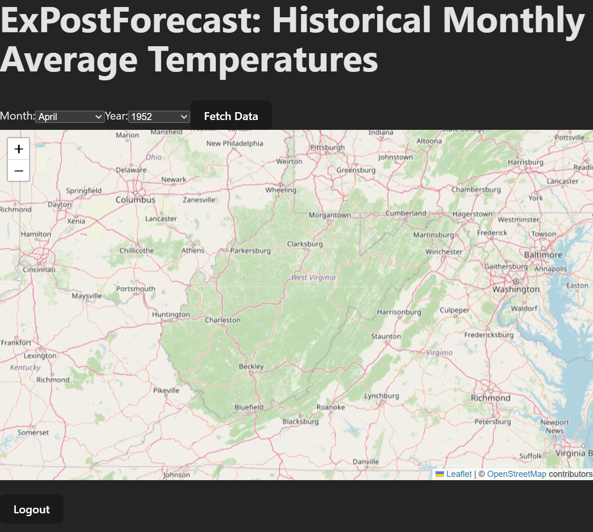

# xPostForecast Frontend (Sprint 1)

The React app at the heart of xPostForecast. In Sprint 1 it is a single page: month and year dropdowns, a **Fetch Data** button, and an interactive Leaflet map of West Virginia. The button and **Logout** are stubs that only write to the browser console; Sprint 2 adds login and Sprint 3 fetches real data.

> **Setting up this frontend yourself?** Read on. **Building your own project for CS 330?** Don't copy this one: follow the [Sprint 1 student guide](https://tdevine1.github.io/xPostForecast/students/sprint-1.html), which walks you through your tools, your team repository, and your own React app, and use this code to see what a finished Sprint 1 looks like.

The overall picture is in the [root README](../README.md).

---

## 1. What it is made of

**Tech stack**

- **Framework:** React 19 + Vite
- **Routing:** React Router
- **Mapping:** Leaflet + React-Leaflet, with OpenStreetMap tiles
- **Loading indicator:** `react-spinners`
- **Tests:** Vitest + Testing Library; **lint:** oxlint (the linter Vite's React template ships with)

**Folder structure**

```text
frontend/
├── index.html
├── package.json
├── vite.config.js            Vite and Vitest settings
├── .oxlintrc.json            lint rules
└── src/
    ├── main.jsx              entry point: renders <App />
    ├── App.jsx               routes (/ redirects to /map; /map shows MapPage)
    ├── index.css             global styles
    ├── components/
    │   ├── DateSelector.jsx  month/year dropdowns + Fetch Data (with DateSelector.test.jsx)
    │   └── MapComponent.jsx  the Leaflet map
    └── pages/
        └── MapPage.jsx       the screen: combines the selector and the map
```

**Why components and pages are separate.** `components/` are reusable widgets (a selector, a map). `pages/` are full screens tied to a route that combine several components. **Why `frontend/` is its own folder.** Sprint 2 adds a `backend/` next to it; keeping them apart keeps their packages, settings, and deployment separate.

---

## 2. Run it locally

You need **Node.js 24 LTS** (current Vite releases don't run on older versions such as Node 18) and Git.

```bash
git clone https://github.com/tdevine1/xPostForecast.git
cd xPostForecast
git switch sprint-1
cd frontend
npm install
npm run dev          # http://localhost:5173
```

Open the address in your browser. The terminal also offers:

```bash
npm run lint         # oxlint: unused variables, hook mistakes, and similar bugs
npm test             # Vitest component tests
npm run build        # production build into dist/
```

Editing a file updates the page instantly without a reload (Vite's *hot reloading*).



---

## 3. How it works

| File | What it does |
|---|---|
| `main.jsx` | Renders `<App />` into the page. |
| `App.jsx` | Sets up React Router. `/` redirects to `/map`; `/map` renders `MapPage`. Sprint 2 adds `/login` and `/register` and puts `/map` behind a login check. |
| `pages/MapPage.jsx` | Holds the chosen `date` and a loading flag. **Fetch Data** warns if no month is chosen, otherwise logs "would fetch…", waits half a second (to show the spinner), and stops. **Logout** only logs. |
| `components/DateSelector.jsx` | Month and year dropdowns (years 1895–2022, the range Planetary Computer's data covers). Calls `onDateChange('YYYY-MM-01')` once both are chosen, and `fetchTemperatureData()` when **Fetch Data** is clicked. Dropdowns mean no free-text date parsing is needed. |
| `components/MapComponent.jsx` | A React-Leaflet map centered on West Virginia. Takes a `temperatures` array of `{ lat, lon, tavg }` points (empty in this sprint). |

Props of the two components:

| Component | Prop | Type | Meaning |
|---|---|---|---|
| `DateSelector` | `onDateChange` | `(date: string) => void` | Called with e.g. `'2020-07-01'` once both month and year are chosen |
| `DateSelector` | `fetchTemperatureData` | `() => void` | Called when **Fetch Data** is clicked |
| `MapComponent` | `temperatures` | `Array<{ lat, lon, tavg }>` | Points to draw; an empty array shows just the map |

---

## 4. Tests and CI

`src/components/DateSelector.test.jsx` is a [Vitest](https://vitest.dev/) test for the dropdowns. The workflow [`.github/workflows/ci.yml`](../.github/workflows/ci.yml) runs `npm ci`, `npm run lint`, `npm test`, and `npm run build` on every push and pull request, so a mistake turns red on GitHub before it can cause harm. New to workflows? See the [GitHub workflows guide](https://tdevine1.github.io/xPostForecast/students/github-workflows.html).

---

## 5. Keep secrets out of Git

This sprint has no secrets, but the habits start now:

- Vite's `frontend/.gitignore` covers `node_modules/` and `dist/` but **not `.env`**. The repository-level `.gitignore` (GitHub's **Node** template) does. Starting in Sprint 2, `.env` files hold settings such as the backend's address and database credentials, and must never be committed.
- `.vscode/settings.json` is ignored too. If you use SQLTools (optional, from Sprint 2) it saves your database connection there, and depending on one setting that can include the database password. This repository's [`.gitignore`](../.gitignore) ignores everything in `.vscode/` except `extensions.json`, which only recommends the extensions.
- Before every `git add`, run `git status` and confirm nothing like `node_modules/`, a `.env` file, or `.vscode/settings.json` is about to be committed.

---

## 6. Troubleshooting

| Symptom | Likely cause | Fix |
|---|---|---|
| `npm install` fails or hangs | A broken download or the wrong folder | Delete `node_modules/` and `package-lock.json`, make sure you are inside `frontend/`, and run `npm install` again |
| `npm` or `node` not recognized | Node.js isn't installed or isn't on your PATH | Reinstall Node.js 24 LTS and restart VS Code |
| "running scripts is disabled on this system" (Windows PowerShell) | PowerShell blocks npm's helper script | See the [fix in the Sprint 1 guide](https://tdevine1.github.io/xPostForecast/students/sprint-1.html#powershell) |
| Errors mentioning an unsupported Node version | Node older than v24 | Run `node --version` and install Node.js 24 LTS |
| `Port 5173 is already in use` | Another dev server is running | Stop it with `Ctrl+C`, or close other terminals running `npm run dev` |
| Blank page, or a component doesn't render | Often a typo in an import path | Open the browser console (`F12`) and read the first error |

---

## 7. References

| Topic | Resource |
|---|---|
| JSX | [React: Writing Markup with JSX](https://react.dev/learn/writing-markup-with-jsx) |
| React Router | [Declarative mode](https://reactrouter.com/start/declarative/installation) |
| Vite | [Vite Guide](https://vite.dev/guide/) |
| Vitest | [Vitest Guide](https://vitest.dev/guide/) |
| React-Leaflet | <https://react-leaflet.js.org/> |

In **Sprint 2** the app gains an Express backend, an Azure MySQL database, and login. Next: [`sprint-2`](https://github.com/tdevine1/xPostForecast/tree/sprint-2).
