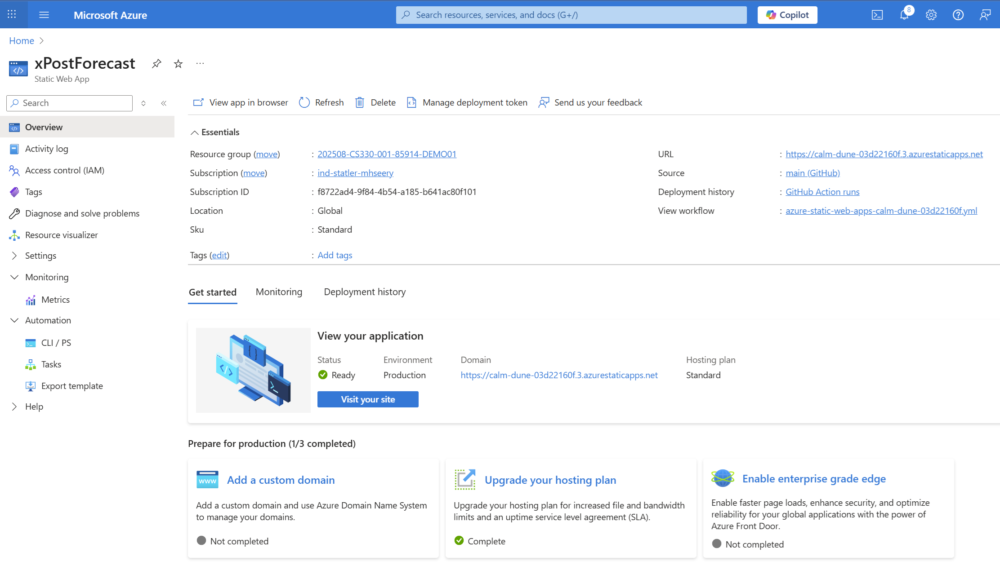
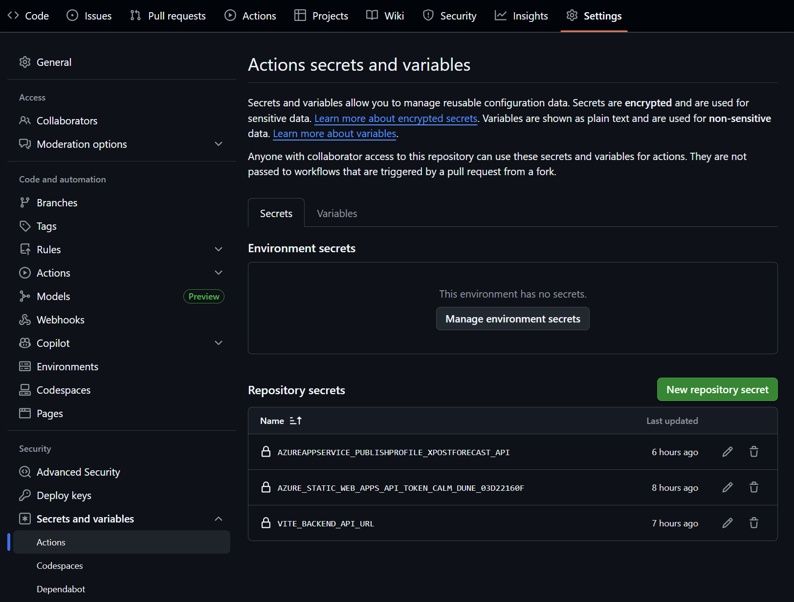
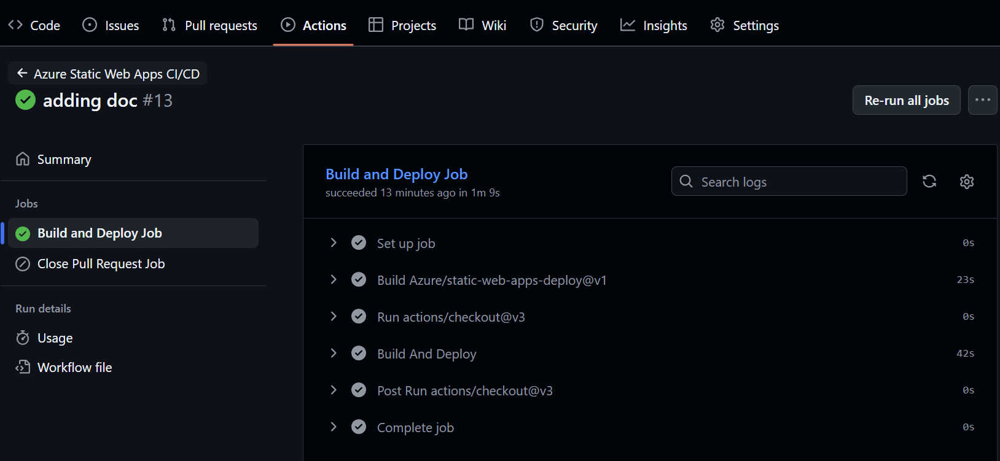

# xPostForecast Frontend

The React app behind xPostForecast. People register and log in, choose a month between 1895 and September 2022, and the app draws West Virginia's average temperatures for that month on an interactive map.

> **Setting up this frontend yourself?** Read on. **Building your own project for CS 330?** Don't copy this one: follow the [student guides](https://tdevine1.github.io/xPostForecast/), such as the [Sprint 4 deployment guide](https://tdevine1.github.io/xPostForecast/students/sprint-4.html), and use this code to see how a finished frontend looks.

The server it talks to is in [`../backend/README.md`](../backend/README.md). The overall picture is in the [root README](../README.md).

---

## 1. What it is made of

**Tech stack**

- **Framework:** React 19 + Vite
- **Routing:** React Router
- **HTTP client:** axios, through one shared instance in `src/api.js`
- **Mapping:** Leaflet + React-Leaflet, with OpenStreetMap tiles
- **Color scale:** `chroma-js`
- **Loading indicator:** `react-spinners`
- **Tests:** Vitest + Testing Library; **lint:** oxlint

**Folder structure** (`src/components/` and `src/pages/` each have a short README):

```text
frontend/
├── .env.example                    VITE_BACKEND_API_URL=http://localhost:5175
├── index.html
├── public/
│   └── staticwebapp.config.json    Azure Static Web Apps settings (refresh fix, Referrer-Policy)
└── src/
    ├── main.jsx                    entry point
    ├── App.jsx                     routes + session check (App.test.jsx tests it)
    ├── api.js                      the shared axios client
    ├── index.css
    ├── components/
    │   ├── DateSelector.jsx        month/year dropdowns + Fetch Data (with its test)
    │   └── MapComponent.jsx        Leaflet map, color scale, canvas rendering
    └── pages/
        ├── Login.jsx
        ├── Register.jsx
        └── MapPage.jsx             the protected page: pick a month, fetch, draw
```

---

## 2. Run it locally

You need **Node.js 24 LTS** and the backend running at <http://localhost:5175> (see the [backend README](../backend/README.md#2-run-it-locally)).

```bash
cd frontend
npm install
cp .env.example .env     # VITE_BACKEND_API_URL=http://localhost:5175
npm run dev              # http://localhost:5173
```

Vite only exposes variables whose names start with `VITE_`, and it reads them when the dev server starts or the app is built, so **restart `npm run dev` after editing `.env`**. The value is the backend's base URL with no trailing slash; the code adds paths such as `/auth/login`.

> Anything in a `VITE_` variable ends up in the JavaScript sent to every visitor. Never put secrets there.

The backend's `FRONTEND_URL` must be exactly `http://localhost:5173`, or the browser's CORS check blocks every request.

---

## 3. How it works

### 3.1 The shared HTTP client (`src/api.js`)

Every backend call goes through one preconfigured axios instance:

```js
const api = axios.create({
  baseURL: import.meta.env.VITE_BACKEND_API_URL, // e.g. http://localhost:5175
  withCredentials: true,                         // send and accept the HTTP-only auth cookie
});
```

- The backend's address comes from `VITE_BACKEND_API_URL` and nothing else, so pointing the app at the Azure backend means changing one variable.
- `withCredentials: true` is set once, so no request can forget the cookie.
- Pages call `api.get('/temperature/2020-07-01')` or `api.post('/auth/login', …)` with just the path.
- The file also logs the address to the browser console (`Frontend API Base URL: …`). `undefined` there means the build didn't get the variable.

### 3.2 Login state and routing (`src/App.jsx`)

1. The login is an **HTTP-only cookie**: the backend sets it, page JavaScript can't read it, and nothing is kept in `localStorage`.
2. On startup, `App.jsx` calls `GET /auth/test`. Success means logged in; any error (`401`, or the backend being unreachable) means logged out. While it waits, the app shows "Checking your session…" so a refresh on `/map` doesn't bounce you to `/login`.
3. Routes:

   | Route | Page | Who can see it |
   |---|---|---|
   | `/` | redirects | everyone |
   | `/login`, `/register` | `Login.jsx`, `Register.jsx` | logged-out users (others go to `/map`) |
   | `/map` | `MapPage.jsx` | **logged-in users only** (others go to `/login`) |

**Why `void` appears in front of some calls.** `navigate(...)` and the `verifyAuth()` call in `App.jsx` start background work and return a promise that nothing waits for. A static-analysis tool such as SonarQube Cloud flags an ignored promise, because an error inside it could disappear silently. `void navigate(...)` says "I know this is a background task and I am choosing not to wait". Anything whose result or failure matters is `await`ed inside `try/catch`, as the login request is.

axios **throws** for any non-2xx status, so "logged in" is decided by whether `api.get('/auth/test')` succeeds or throws. (The browser's built-in `fetch` instead resolves for every status and you check `res.ok`.)

### 3.3 Login and registration

- `Login.jsx` posts `{ username, password }` to `/auth/login`. On success it marks the user as logged in and goes to `/map`. A `401` shows "Invalid credentials".
- `Register.jsx` posts `{ email, username, password }` to `/auth/register`, then goes to `/login`. Errors show the backend's message (for example, the username or email is already registered, or the password is under 8 characters).

### 3.4 The map page (`src/pages/MapPage.jsx`)

| State | Meaning |
|---|---|
| `date` | `'YYYY-MM-01'` from `DateSelector` |
| `temperatureData` | array of `{ lat, lon, tavg }` passed to the map |
| `isLoading` | shows the spinner while a request runs |
| `error` | message shown under the selectors, or empty |

**Fetch Data** does this:

1. No month chosen yet: show "Please select a month and year."
2. `api.get(`/temperature/${date}`)`.
3. Success: `temperatureData` becomes the returned array, and `MapComponent` redraws.
4. `401`: the session expired, so mark the user logged out and go to `/login`.
5. Any other error: empty the map and show the backend's message (`404` "No temperature data is available for 2022-12", `502` "The temperature data service is unavailable…"), or "Could not reach the server" if there was no answer.

**Logout** calls `POST /auth/logout` and returns to `/login`, even if the request fails. The first request for a month can take several seconds because the backend goes out to Planetary Computer; the backend caches each month, so repeats are fast.

### 3.5 Choosing a month (`src/components/DateSelector.jsx`)

Month and year dropdowns (years 1895–2022, newest first). It calls `onDateChange('YYYY-MM-01')` once both are chosen, and `fetchTemperatureData()` when **Fetch Data** is clicked. The data set ends in **September 2022**, so October–December 2022 give the "no data" message.

### 3.6 Drawing the map (`src/components/MapComponent.jsx`)

- A `MapContainer` centered on West Virginia (zoom 7) with OpenStreetMap tiles.
- One `CircleMarker` per point (radius 25 px, no outline, so neighbors blend into a continuous surface), with a popup showing latitude, longitude, and temperature.
- Colors come from a `chroma-js` scale from dark blue (−10 °F) through yellow to dark red (110 °F):

  ```js
  const scale = chroma
    .scale(['#002366', '#4169E1', '#87CEEB', '#FFFF66', '#FFD700', '#FF4500', '#B22222'])
    .domain([-10, 110]);
  ```

- `preferCanvas` makes Leaflet draw all ~9,700 circles on one `<canvas>` instead of ~9,700 separate elements, which is much faster.
- The tile layer sets `referrerPolicy="strict-origin-when-cross-origin"`, so OpenStreetMap's servers always see which site is asking (see 5.4).

### 3.7 Date to map, end to end

1. The user picks a month and year; `MapPage` stores `'2020-07-01'`.
2. The user clicks **Fetch Data**; `MapPage` calls `api.get('/temperature/2020-07-01')`, with the cookie.
3. The backend checks the cookie, then (if the month isn't cached) searches the STAC API, signs the GeoTIFF URL, reads the West Virginia window, and returns about 9,700 `{ lat, lon, tavg }` points ([backend README](../backend/README.md#5-get-temperaturedate-routesstacjs)).
4. `MapPage` stores the array and `MapComponent` draws it.

---

## 4. Tests and build

```bash
npm test                 # Vitest + Testing Library
npm run lint             # oxlint
npm run test:coverage    # coverage report in coverage/ (lcov for SonarQube)
npm run build            # production bundle in dist/
```

`App.test.jsx` replaces the `api` module with a mock and checks that a valid session stays on `/map` after a refresh, a logged-out visitor is sent to `/login`, Fetch Data requests the chosen month and hands the points to the map, a `404` shows the backend's message, and an expired session (`401`) returns to `/login`. `DateSelector.test.jsx` covers the dropdowns, `Login.test.jsx` and `Register.test.jsx` cover the forms (success, wrong password, taken username, backend down), `MapPage.test.jsx` covers the empty-month, error, and logout paths, `MapComponent.test.jsx` checks the colors, popups, and tile settings (with Leaflet replaced by stand-ins), and `api.test.js` checks the client's address and cookie setting.

`VITE_BACKEND_API_URL` is baked into the bundle **at build time**. The deployed site is just static files with no server-side environment to read later, so when the address changes you must build again. In the cloud, GitHub Actions sets it to the Azure backend's address before building.

---

## 5. Deploy to Azure Static Web Apps

You need a Static Web App (the **Free** plan is enough), and the backend should already be deployed and passing `/health` ([backend README, section 7](../backend/README.md#7-deploy-to-azure-app-service)).

The Static Web App's **Overview** page shows its URL and the **Manage deployment token** button used below:



### 5.1 Choose how it deploys: pick one

| | **A. Azure-generated workflow** | **B. This repo's workflow** |
|---|---|---|
| When | The Static Web App was connected to GitHub, so Azure committed `.github/workflows/azure-static-web-apps-<name>.yml` | You use the workflow already in this repo |
| Who builds the app | Azure's build service (Oryx), inside the action | The workflow (`npm ci`, `npm test`, `npm run build`), then it uploads `dist/` |
| Token secret | Created by Azure: `AZURE_STATIC_WEB_APPS_API_TOKEN_<NAME>` | You add `AZURE_STATIC_WEB_APPS_API_TOKEN` yourself |
| Tests before deploy | No | Yes |

**Use only one**, or every push deploys twice. This repo uses **B**: [`.github/workflows/deploy-frontend.yml`](../.github/workflows/deploy-frontend.yml). It runs on pushes to `main` that touch `frontend/` (and has a **Run workflow** button), runs the tests, builds with `VITE_BACKEND_API_URL`, and uploads the finished `frontend/dist` folder with `skip_app_build: true`. Every line is explained in the [workflows guide](https://tdevine1.github.io/xPostForecast/students/github-workflows.html#frontend). If Azure generated a workflow file for you, delete it.

If you would rather keep the Azure-generated file (option A), open it, find the `Azure/static-web-apps-deploy@v1` step in `build_and_deploy_job`, and make sure it says:

```yaml
        with:
          azure_static_web_apps_api_token: ${{ secrets.AZURE_STATIC_WEB_APPS_API_TOKEN_<NAME> }}  # leave as generated
          repo_token: ${{ secrets.GITHUB_TOKEN }}
          action: "upload"
          app_location: "frontend"   # folder with the frontend's package.json
          api_location: ""           # no SWA-managed API; our backend is on App Service
          output_location: "dist"    # where Vite puts the build, relative to app_location
        env:
          VITE_BACKEND_API_URL: ${{ secrets.VITE_BACKEND_API_URL }}   # add this
```

The `env:` block is easy to miss: without it the build has no backend URL and every API call fails. If VS Code complains that `app_location` is missing in the generated `close_pull_request_job`, add the same line there. If Azure's build fails with an unsupported Node version, switch to option B, where the workflow chooses Node.

### 5.2 Add the secrets and variables

In GitHub: **Settings → Secrets and variables → Actions** (only a repository **Admin** can see Settings).

| Name | Kind | Value | Needed for |
|---|---|---|---|
| `VITE_BACKEND_API_URL` | Secret | `https://` + the backend's **Default domain** from its App Service Overview page, **no trailing slash**. Copy it; don't type it from memory (portal-created apps have a random suffix) | A and B |
| `AZURE_STATIC_WEB_APPS_API_TOKEN` | Secret | the deployment token: Static Web App → Overview → **Manage deployment token** → copy | B only |
| `DEPLOY_TO_AZURE` | Variable | `true` (the deploy workflows skip themselves otherwise) | B |



*(This screenshot shows secrets generated by Azure for option A.)*

**Why the URL is needed at build time:** Vite replaces `import.meta.env.VITE_BACKEND_API_URL` with the actual text of the address while building. **Is the URL secret?** Not really, because it ends up in the JavaScript anyone can download; a secret is just a convenient place to keep it out of the code. Never put real secrets in a `VITE_` variable.

### 5.3 Make page refreshes work: `staticwebapp.config.json`

A Static Web App serves files. A request for `/map` looks for a file named `map`, finds none, and returns **404**, even though React Router knows the page. [`public/staticwebapp.config.json`](./public/staticwebapp.config.json) sends unknown paths to `index.html`:

```json
{
  "navigationFallback": {
    "rewrite": "/index.html",
    "exclude": ["/assets/*", "/*.{svg,png,ico,json}"]
  },
  "globalHeaders": {
    "Referrer-Policy": "strict-origin-when-cross-origin"
  }
}
```

Vite copies everything in `public/` into `dist/`, so the file deploys with the site. `exclude` keeps real files (scripts, images) from being rewritten.

### 5.4 Why `globalHeaders` is there: the map tiles

Every page request sends the browser a few rules. One, `Referrer-Policy`, decides whether the browser tells *other* websites which page a request came from (the `Referer` header). Azure Static Web Apps otherwise sends `same-origin`, meaning "tell nobody else". The map's background tiles come from OpenStreetMap, whose usage policy asks apps to send that header, so with `same-origin` the tiles are refused and show "Access blocked". It works on your own computer because browsers send it by default, so the problem appears only after you deploy. The map component also sets `referrerPolicy` on the `TileLayer` itself, as a second safeguard.

### 5.5 Cookies between two sites

The deployed frontend (`*.azurestaticapps.net`) and backend (`*.azurewebsites.net`) are **different sites**:

- Browsers include a cookie in **cross-site** requests only if it is marked `SameSite=None` **and** `Secure`.
- The backend does this when its App Service setting `NODE_ENV` is `production`: the cookie becomes `HttpOnly; Secure; SameSite=None; Partitioned`. `Partitioned` ties the cookie to your frontend's site, which lets it work in browsers that restrict third-party cookies.
- The frontend already sends cookies on every request (`withCredentials: true`), and the backend's CORS allows exactly `FRONTEND_URL` with credentials.

If login returns 200 but the next request is `401`, the cookie isn't being sent: check `NODE_ENV=production` and `FRONTEND_URL` on the App Service. Some browsers or strict privacy settings block cross-site cookies even so; if login works in one browser but not another, that's the likely cause. The complete fix is to serve both halves from the same site (for example custom domains `app.example.edu` and `api.example.edu`).

### 5.6 Deploy and verify

Commit and push to `main` (or **Actions → Deploy frontend (Static Web Apps) → Run workflow**), and watch the **Actions** tab. When it is green, the site is live.



Visit the Static Web App address with the browser's developer tools open (F12):

- **Console:** `Frontend API Base URL: https://<your-backend>.azurewebsites.net`. If it says `undefined`, the build didn't get `VITE_BACKEND_API_URL`.
- **Login** works, and in the **Network** tab requests go to `https://<your-backend>.azurewebsites.net/auth/...` with no CORS errors.
- **Refresh on `/map`:** you stay on the map (no 404, no bounce to login).
- **Fetch Data:** temperatures appear (any month from 1895 to September 2022).
- **Map background:** a real street map appears under the colored layer.
- **Logout:** back to `/login`.

The first login after a deploy can be slow while the backend wakes up (a cold start). Wait a minute and try again.

---

## 6. Troubleshooting

| Symptom | Likely cause | Fix |
|---|---|---|
| Red `401` for `/auth/test` in the console | Not logged in | Normal before login and after logout |
| Login works but a refresh logs you out (locally) | Cookie not stored or sent | `withCredentials: true` on the client; the backend's CORS needs `credentials: true`; `FRONTEND_URL` must match exactly |
| `Network Error` or `Failed to fetch` | Backend not running, wrong `VITE_BACKEND_API_URL`, or CORS | Start the backend; check `.env` and restart `npm run dev`; read the console's CORS message |
| `VITE_BACKEND_API_URL` is `undefined` (local) | `.env` missing, or dev server not restarted | Create `frontend/.env`, restart `npm run dev` |
| Console shows `Frontend API Base URL: undefined` (deployed) | The build didn't receive the URL | Option A: add the `env:` block; both: check the secret's name |
| Requests go to `…/undefined/auth/login` or to the site's own address | Same as above | Same as above |
| `404` when refreshing `/map` or `/login` | Missing `staticwebapp.config.json` | Keep it in `frontend/public/` (5.3) |
| CORS error in the console | Backend `FRONTEND_URL` ≠ the site's address | Set it to the exact address, no trailing slash |
| Login succeeds, then you are logged out / `401` | Cookie not sent between the two sites | Backend `NODE_ENV=production` (5.5) |
| Workflow error about the deployment token | Wrong or missing token secret | Copy it again from **Manage deployment token** |
| Deploy step says the app directory location is invalid | A: `app_location` isn't the folder with `package.json`. B: the build didn't produce `frontend/dist` | Fix the path; for B check the Build step's log |
| Every push deploys twice | Both an Azure-generated and the repo's workflow | Keep one (5.1) |
| Workflow shows as skipped | `DEPLOY_TO_AZURE` isn't `true` | Set the repository variable |
| The map is grey squares: "Access blocked: App is not following the tile usage policy" | The site tells the browser not to send a `Referer`, and OpenStreetMap requires one | Keep `globalHeaders` in `staticwebapp.config.json` (5.3) and `referrerPolicy` on the `TileLayer`; redeploy; hard-reload (Ctrl+Shift+R) |
| Console shows `ERR_NAME_NOT_RESOLVED` for the backend | `VITE_BACKEND_API_URL` is a guessed address | Copy the backend's **Default domain**, update the secret, and **redeploy the frontend** (the address is baked in at build time) |
| Green workflow but the site looks unchanged | The browser cached the old version | Hard-reload or try a private window |
| Register says the password must be at least 8 characters | Backend validation | Use a longer password |

---

## 7. References

- React Router: <https://reactrouter.com/>
- Axios: <https://axios-http.com/>
- Vite environment variables: <https://vite.dev/guide/env-and-mode>
- React-Leaflet: <https://react-leaflet.js.org/>
- MDN CORS: <https://developer.mozilla.org/docs/Web/HTTP/Guides/CORS>
- MDN Cookies: <https://developer.mozilla.org/docs/Web/HTTP/Guides/Cookies>
